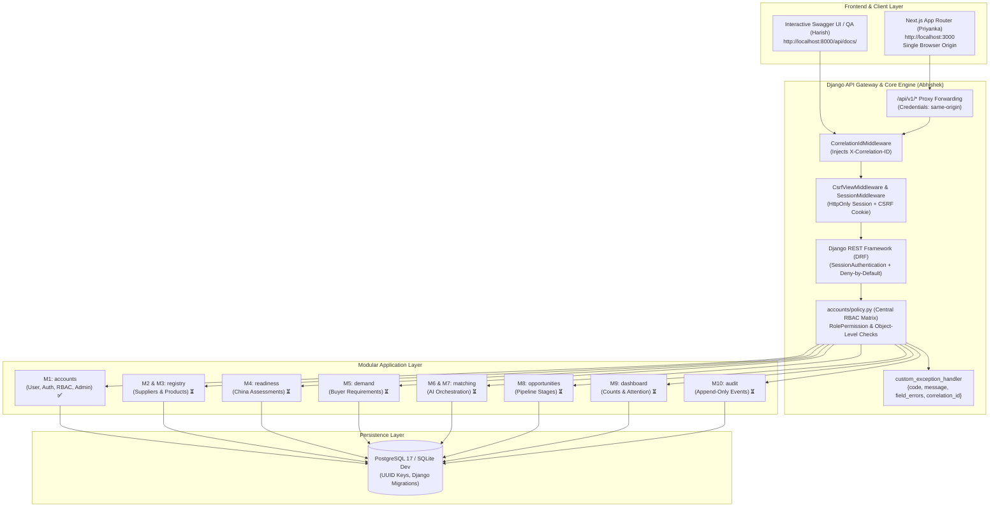

# ⚡ InChi Pilot Gateway — Backend Architecture, Progress & Testing Guide

> **Module Owner:** Abhishek Kumar (Application Backend & Access-Control Engineer)  
> **Status:** Week 1 Completed (Auth, Custom User, RBAC Policy, Verification & API Skeleton)  
> **Date:** 29 October 2026  
> **Document Purpose:** Presentation script for team meetings, architecture walkthrough, and independent testing instructions for QA, Frontend, and Security peers.

---

## 🎙️ 1. Presentation Script: What to Say in the Team Meeting

*Use this section as your spoken talking points during your progress update or demo.*

---

> ### **Opening Pitch (30 seconds)**
> "Hello everyone, I’m Abhishek, leading the **Application Backend and Access-Control** workstream for the InChi Pilot Gateway.  
> Today, I have built and verified our core **Django backend foundation**, our **Custom User & Role-Based Access Control (RBAC) engine**, and the complete **Authentication & Account Verification lifecycle**."

---

> ### **Key Concept & Workflow Clarity (45 seconds)**
> "Before jumping into code, I aligned our backend boundaries with the project documents:
> 1. **Who the Users Are:** This is an **internal BNCS platform**. The users logging into the system are BNCS staff, categorized into three distinct internal roles:
>    - **Platform Administrator:** Manages accounts, access, and system settings.
>    - **Commercial Analyst:** Manages Indian suppliers/products, logs Chinese buyer requirements, and runs matching.
>    - **Reviewer / Approver:** Evaluates supplier China-readiness, checks match explanations, and records official commercial decisions.
> 2. **Exporters & Buyers:** They are **commercial records** in our database managed by our analysts, not external public logins.
> 3. **Verification:** In our pilot, verification is an internal workflow tracking mechanism (and security token validation), not a paid third-party API like PAN or Aadhaar."

---

> ### **What I Have Implemented Today (60 seconds)**
> "Here is what is fully built, migrated, and passing tests right now:
> - **Zero-Trust RBAC Policy (`policy.py`):** We have a single source of truth for all permissions across all 10 modules. It is deny-by-default.
> - **Custom User Model:** Uses immutable UUID primary keys, email authentication, role choices, and optimistic concurrency version tracking.
> - **Full Auth Suite:** Session-based authentication with CSRF cookie rotation, login, logout, and `/me` endpoint for frontend route guarding.
> - **Registration & Verification Pipeline:** Users can be onboarded, assigned a role, issued a secure verification token, and verified.
> - **Platform Admin User Management:** Admins can list all users, activate/deactivate accounts, with built-in protection against self-deactivation.
> - **Production Guardrails:** Global exception handler returning structured errors (`{code, message, field_errors, correlation_id}`) and Correlation ID tracing middleware.
> - **Interactive Swagger UI:** Available out of the box at `/api/docs/` with zero schema errors.
> - **Verification:** 100% of our automated unit & permission tests pass."

---

> ### **Handoff to Team (15 seconds)**
> "I have prepared a step-by-step testing guide in this document so that Priyanka on Frontend, Harish on QA, and Ajendra on Security can run and test every single endpoint right now. Let me walk you through the architecture."

---

## 🏗️ 2. System Architecture



---

## 📁 3. Backend Folder Structure

```text
django-backend/
├── manage.py                          # Django CLI utility
├── requirements.txt                   # Production dependencies (Django 5.2, DRF, etc.)
├── requirements-dev.txt               # Testing & linting tools (pytest, ruff)
├── .env.example                       # Committed environment variable template
├── .env                               # Local environment variables (git-ignored)
├── .gitignore                         # Strict secrets and cache exclusion
├── openapi-schema.yaml                # Auto-generated OpenAPI v3 specification
├── config/                            # Core Project Configuration
│   ├── __init__.py
│   ├── settings.py                    # App settings, DB fallback, Session & CSRF config
│   ├── urls.py                        # Root router (/api/v1/auth/, /api/docs/, /health/)
│   ├── wsgi.py / asgi.py              # WSGI & ASGI deployment entrypoints
│   ├── exceptions.py                  # Standardized production exception handler
│   └── middleware.py                  # X-Correlation-ID request tracing middleware
└── apps/                              # Domain-Driven Modular Apps
    ├── accounts/                      # [COMPLETED] M1: Authentication & Access Control
    │   ├── models.py                  # Custom User (UUID PK, Role choices, is_verified, version)
    │   ├── policy.py                  # Centralized RBAC permission policy matrix
    │   ├── permissions.py             # RolePermission, IsPlatformAdmin, etc.
    │   ├── serializers.py             # UserSerializer, Login, Register, VerifyAccount
    │   ├── views.py                   # Csrf, Login, Logout, Me, Register, Verify, Users
    │   ├── urls.py                    # Modular auth routes
    │   ├── admin.py                   # Restricted Django admin for Platform Admin
    │   ├── management/commands/
    │   │   └── create_platform_admin.py # CLI for least-privilege admin creation
    │   ├── migrations/
    │   │   └── 0001_initial.py        # Authoritative custom User migration
    │   └── tests/
    │       └── test_auth.py           # Automated unit, auth & RBAC test suite
    ├── registry/                      # [Ready] M2/M3: Supplier & Product registry
    ├── readiness/                     # [Ready] M4: China-readiness assessments
    ├── demand/                        # [Ready] M5: Buyer requirements
    ├── matching/                      # [Ready] M6: Match runs & orchestration
    ├── opportunities/                 # [Ready] M8: Commercial opportunity pipeline
    ├── audit/                         # [Ready] M10: Append-only audit history
    └── dashboard/                     # [Ready] M9: Metrics & attention list
```

---

## 📡 4. Implemented Endpoints & Behavior Catalog

All endpoints return HTTP status codes and the standard error envelope on failure:
```json
{
  "code": "error_code_string",
  "message": "Human-readable explanation.",
  "field_errors": { "field_name": ["Specific error detail."] },
  "correlation_id": "3fa85f64-5717-4562-b3fc-2c963f66afa6"
}
```

### Endpoint Summary Table

| Method | Endpoint | Allowed Roles | Description |
|---|---|---|---|
| `GET` | `/api/v1/health/` | Public | Readiness probe (`{"status": "ok"}`) |
| `GET` | `/api/docs/` | Public | Interactive Swagger UI documentation |
| `GET` | `/api/schema/` | Public | OpenAPI JSON/YAML raw schema |
| `GET` | `/api/v1/auth/csrf/` | Public | Sets `csrftoken` cookie for client apps |
| `POST` | `/api/v1/auth/register/` | Public / Admin | Register new internal user with role |
| `POST` | `/api/v1/auth/verify/` | Public | Verify account using issued verification token |
| `GET` | `/api/v1/auth/verify/status/` | Public | Query verification status of an email |
| `POST` | `/api/v1/auth/login/` | Public + CSRF | Authenticate, establish session, rotate CSRF |
| `GET` | `/api/v1/auth/me/` | Authenticated | Get current logged-in user profile & role |
| `POST` | `/api/v1/auth/logout/` | Authenticated | Flush session and logout |
| `GET` | `/api/v1/auth/users/` | **Platform Admin only** | List all internal user accounts |
| `POST` | `/api/v1/auth/users/{id}/deactivate/` | **Platform Admin only** | Soft-deactivate user account |
| `POST` | `/api/v1/auth/users/{id}/activate/` | **Platform Admin only** | Reactivate user account |

---

## 🧪 5. Independent Testing Guide (How Teammates Can Test)

Any team member (Harish, Priyanka, Ajendra) can independently run and test these features in under 5 minutes.

### Step 5.1: Setup and Run the Server
From the root of `django-backend`:

```powershell
# 1. Activate the Python virtual environment
.\.venv\Scripts\Activate.ps1

# 2. Run existing migrations (if not already applied)
python manage.py migrate

# 3. Create a test Platform Administrator
python manage.py create_platform_admin --email admin@bncs.local --password "AdminPass123!" --allow-additional

# 4. Start the Django development server
python manage.py runserver 127.0.0.1:8000
```

---

### Step 5.2: Test Interactively in the Browser (Easiest Method)
1. Open your browser and visit: **`http://127.0.0.1:8000/api/docs/`**
2. You will see the complete **Swagger UI**.
3. You can execute requests directly through the UI:
   - Call `GET /api/v1/health/` → Receive `200 OK`.
   - Call `GET /api/v1/auth/csrf/` → Initializes session & CSRF cookie.
   - Call `POST /api/v1/auth/register/` → Create a test user.

---

### Step 5.3: End-to-End Command Line Testing Flow

#### Test Case 1: Check System Health
```powershell
curl.exe -X GET "http://127.0.0.1:8000/api/v1/health/"
```
*Expected Response (`200 OK`):*
```json
{"status": "ok", "service": "inchi-backend", "timestamp": "..."}
```

---

#### Test Case 2: Register a New Commercial Analyst
```powershell
curl.exe -X POST "http://127.0.0.1:8000/api/v1/auth/register/" `
  -H "Content-Type: application/json" `
  -d '{\"email\": \"analyst.test@bncs.local\", \"password\": \"StrongPass123!\", \"first_name\": \"Analyst\", \"last_name\": \"One\", \"role\": \"commercial_analyst\"}'
```
*Expected Response (`201 Created`):*
```json
{
  "message": "User registered successfully. Please complete verification.",
  "user": {
    "email": "analyst.test@bncs.local",
    "role": "commercial_analyst",
    "role_display": "Commercial Analyst",
    "is_verified": false
  },
  "verification_token": "a1b2c3d4-..."
}
```
*(Copy the `verification_token` returned from this step).*

---

#### Test Case 3: Verify the Account
```powershell
curl.exe -X POST "http://127.0.0.1:8000/api/v1/auth/verify/" `
  -H "Content-Type: application/json" `
  -d '{\"email\": \"analyst.test@bncs.local\", \"token\": \"<PASTE_VERIFICATION_TOKEN_HERE>\"}'
```
*Expected Response (`200 OK`):*
```json
{
  "message": "Account successfully verified. You may now log in.",
  "user": {
    "email": "analyst.test@bncs.local",
    "is_verified": true
  }
}
```

---

#### Test Case 4: Login & Establish Session
```powershell
# 1. Fetch CSRF cookie and save cookies to a jar
curl.exe -c cookies.txt "http://127.0.0.1:8000/api/v1/auth/csrf/"

# 2. Login with credentials using the cookie jar
curl.exe -b cookies.txt -c cookies.txt -X POST "http://127.0.0.1:8000/api/v1/auth/login/" `
  -H "Content-Type: application/json" `
  -d '{\"email\": \"analyst.test@bncs.local\", \"password\": \"StrongPass123!\"}'
```
*Expected Response (`200 OK`):*
```json
{
  "message": "Login successful.",
  "user": {
    "email": "analyst.test@bncs.local",
    "role": "commercial_analyst",
    "is_active": true
  }
}
```

---

#### Test Case 5: Verify Session and Current Role (`/me`)
```powershell
curl.exe -b cookies.txt -X GET "http://127.0.0.1:8000/api/v1/auth/me/"
```
*Expected Response (`200 OK`):*
```json
{
  "email": "analyst.test@bncs.local",
  "role": "commercial_analyst",
  "role_display": "Commercial Analyst",
  "is_staff": false
}
```

---

#### Test Case 6: Verify RBAC Deny-by-Default (Negative Security Test)
The Commercial Analyst tries to access the Platform Admin User Management API:
```powershell
curl.exe -b cookies.txt -X GET "http://127.0.0.1:8000/api/v1/auth/users/"
```
*Expected Response (`403 Forbidden`):*
```json
{
  "code": "permission_denied",
  "message": "You do not have permission to perform this action.",
  "field_errors": {},
  "correlation_id": "..."
}
```
✅ *Access is securely denied on the backend.*

---

#### Test Case 7: Admin Privileges & Self-Deactivation Guard
Login as Platform Admin (`admin@bncs.local`):
```powershell
# Login as admin
curl.exe -b cookies.txt -c cookies.txt -X POST "http://127.0.0.1:8000/api/v1/auth/login/" `
  -H "Content-Type: application/json" `
  -d '{\"email\": \"admin@bncs.local\", \"password\": \"AdminPass123!\"}'

# Admin can list all users (200 OK)
curl.exe -b cookies.txt -X GET "http://127.0.0.1:8000/api/v1/auth/users/"

# Admin tries to deactivate their OWN account (403 Forbidden)
# Replace <ADMIN_UUID> with the admin's id
curl.exe -b cookies.txt -X POST "http://127.0.0.1:8000/api/v1/auth/users/<ADMIN_UUID>/deactivate/"
```
*Expected Response:*
```json
{
  "code": "permission_denied",
  "message": "You cannot deactivate your own account."
}
```

---

### Step 5.4: Run Automated Regression Tests
To verify all 7 test cases automatically in 1 command:

```powershell
python manage.py test apps.accounts
```
*Expected Output:*
```text
Creating test database for alias 'default'...
.......
----------------------------------------------------------------------
Ran 7 tests in 12.596s

OK
Destroying test database for alias 'default'...
```

---

## 🤝 6. Team Integration Notes

### For Priyanka (Frontend Web & Client-Side Integration)
- **API Base:** Forward calls to `/api/v1/*`.
- **Session Auth:** Use `credentials: 'same-origin'` in fetch calls.
- **CSRF Token:** On app boot, call `GET /api/v1/auth/csrf/` to set the `csrftoken` cookie. Send its value in the `X-CSRFToken` header for write requests (`POST`, `PUT`, `PATCH`, `DELETE`).
- **Route Guards:** Call `GET /api/v1/auth/me/` inside your `(workspace)` layout to know the active role (`platform_admin`, `commercial_analyst`, `reviewer`) and dynamically show/hide tabs.
- **Error Handling:** Every error returns `{ "code": "...", "message": "...", "field_errors": { "field": ["detail"] } }`. Show `field_errors` next to corresponding inputs.

### For Harish (QA & Test Automation)
- Automated unit and permission tests are located at `apps/accounts/tests/test_auth.py`.
- Run them anytime with `python manage.py test apps.accounts`.
- Traceability: M1 (Access Control) criteria M1-AC1 through M1-AC5 are verified.

### For Ajendra (Cybersecurity & DevSecOps)
- Passwords are strictly validated using Django's built-in password validators (minimum 8 characters, common passwords rejected).
- CSRF protection is enforced with session rotation upon login.
- Zero raw exception stack traces are exposed to API clients.
- `policy.py` contains the central RBAC authorization policy for audit and review.

---

*Authored by Abhishek Kumar — Application Backend & Access-Control Engineer*
