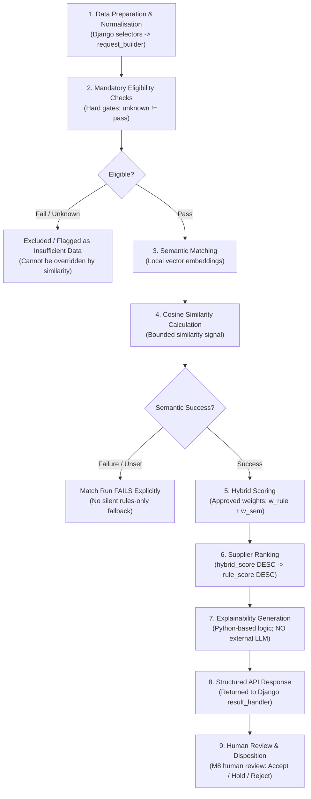

# InChi Pilot Gateway v0.1 — Architecture and Technology Stack

| | |
|---|---|
| **Status** | **Team-selected stack, revised 28 Oct 2026 (D-01).** It is the stack the team builds on. BNCS and mentor approval of the stack and its deviations from the build manual is **pending** (§10). The embedding model (D-11) and any LLM (D-20) are **TBD**. |
| **Applies to** | All code in this repository. |
| **Change rule** | Changing anything in §1 (adding a language, framework, database, service or hosted dependency) needs a new entry in §9, reviewed by the affected owners and Ajendra and recorded by Aryan. Routine libraries inside an owner's area follow the dependency rule in AGENTS.md §B. |
| **Section owners** | Abhishek (backend, conventions, §5), Priyanka (§7), Vishal (database and data sections), Alok (§6). Aryan records §9 and §10. Ajendra reviews security-relevant changes. |

Nothing below is implemented yet. This document fixes **what** the team builds on and **where** each part lives, so the Week 1 skeletons can start.

**How to read decisions here.** **Selected**: chosen by the team, and still waiting for an approval named in §10. **Resolved**: a team technical decision with no further approval needed. **TBD / Open**: not decided; do not pick a value in code. **Superseded**: replaced by a later entry, kept so that existing references still resolve.

---

## 1. Stack

| Layer | Choice | Version line | Owner | Status |
|---|---|---|---|---|
| Frontend framework | **Next.js with the App Router**, React and TypeScript | Next.js: latest stable major at skeleton. React 19 (as Next.js requires). TypeScript pinned at skeleton. | Priyanka | Selected (D-01) |
| Frontend runtime | Node.js, running the Next.js server (`next start` / standalone output) | Active LTS line at skeleton, pinned in `package.json` `engines` | Priyanka | Selected (D-01) |
| Frontend libraries | TanStack Query (server state: loading, error, retry). Routing comes from the App Router. | pinned at skeleton | Priyanka | Selected |
| API types | `openapi-typescript` generates TS types from the backend schema | dev only | Priyanka | Selected |
| Backend language | Python | 3.12 | Abhishek | Selected (D-01) |
| Backend framework | Django | 5.2 LTS | Abhishek | Selected (D-01) |
| API layer | Django REST Framework, plus drf-spectacular for the OpenAPI schema | pinned at skeleton | Abhishek | Selected (D-01) |
| Auth | Django's built-in auth: session cookie, CSRF protection, PBKDF2 password hashing | (built-in) | Abhishek | Resolved (D-12) |
| Database | **PostgreSQL with the pgvector extension**, accessed through the Django ORM with psycopg 3 | PostgreSQL 17. pgvector version pinned at skeleton through the database image tag. | Vishal | Selected (D-01) |
| Schema management | **Django ORM and Django migrations are authoritative.** The pgvector extension and every vector column are created by Django migrations, using the `pgvector` Python package's Django integration. No hand-written schema outside migrations. | (built-in) | Vishal | Selected (D-01) |
| Matching engine | **Two-component architecture:** Django matching integration layer (`backend/apps/matching/`) coordinating data collection and persistence, communicating with the FastAPI AI Matching Engine (`backend/ai_matching/`) for input validation, embeddings, mandatory eligibility evaluation, semantic similarity, hybrid scoring, ranking, and explainability. Semantic matching is mandatory; semantic processing failure explicitly fails the run (no silent fallback). | — | Alok | Defined; deployment config pending (D-01, D-15) |
| Semantic embeddings | Local embedding generation (`sentence-transformers` or `FastEmbed`, pending confirmation). **Embedding model: TBD (D-11).** | library evaluated; model not chosen | Alok | Library pending; **model TBD** |
| LLM | **None in v0.1. Provider and model TBD (D-20).** An LLM is not a prerequisite for the MVP. No LLM SDK, configuration or prompt is added to the codebase. | — | — | **TBD** |
| Backend tests | pytest + pytest-django | — | code owners; Harish | Selected |
| Frontend tests | Vitest + React Testing Library | — | Priyanka; Harish | Selected |
| End-to-end tests | Playwright (TypeScript) | — | Harish | Selected |
| Lint and format | Python: Ruff (lint, format, and `S` security rules). TS: ESLint with the Next.js config, Prettier and `tsc`. | — | owners | Selected |
| Security checks | `pip-audit`, `npm audit`, gitleaks, Dependabot, `manage.py check --deploy` | — | Ajendra | Selected |
| Packaging | pip with pinned `requirements*.txt`; npm with `package-lock.json` | — | owners | Selected |
| Local environment | Docker Compose: `db` (PostgreSQL 17 + pgvector), `backend` (Django under gunicorn) and `frontend` (Next.js server) | Compose v2 | Abhishek, Vishal (db), Priyanka (frontend service) | Selected |
| CI | GitHub Actions | — | Harish (tests), Ajendra (security) | Selected |
| Tracking | GitHub Issues and Projects in this repository | — | Aryan | Resolved (D-18) |

**Runtime requirements.** To run the full stack you need:

- Docker with Compose v2. For native development, also Python 3.12 and the pinned Node.js LTS.
- The default build runs **rules-only**: no PyTorch and no model download.
- Semantic matching adds the optional `requirements-semantic.txt` install (CPU-only PyTorch, roughly a few hundred MB). The model's own download size is unknown until D-11 is decided.
- No GPU is required or assumed.

**Version rule.** "Pinned at skeleton" means:

- When the owner creates the skeleton, they choose the latest stable release that fits the version lines above.
- They pin exact versions in `requirements*.txt`, `package-lock.json` and the database image tag.
- They record those versions in the skeleton PR.

After that, versions change only through Dependabot or an owner PR that runs the full CI. Major-version upgrades need a §9 entry.

**Explicitly not used in v0.1:**

- Spring Boot or a JVM.
- External hosted AI or embedding APIs (all embeddings and matching execute locally).
- Any vector database other than pgvector inside PostgreSQL.
- An external AI, embedding or LLM API. Pilot data never leaves the environment.
- An LLM of any kind, until D-20 is decided and approved.
- Next.js as a second backend. That rules out Route Handlers, Server Actions and middleware holding business logic, authorisation or secrets (§7).
- Redis, message queues or Celery; Elasticsearch; Kubernetes; cloud-managed services.
- A UI component framework, a global state library or a form library.
- GPU-specific dependencies.

A proposal to add any of these needs a §9 entry.

---

## 2. Why this stack

The build manual (§7) recommends a baseline of Next.js, Spring Boot, PostgreSQL, a separate Python/FastAPI matching service, and pgvector "where approved". The team kept the parts that fit an eight-week internal pilot and removed the parts that add integration risk without user value. §10 lists every difference and the approval each one needs.

| Decision | Reason |
|---|---|
| **Next.js App Router + React + TypeScript** | Follows the manual's frontend baseline, and the App Router is the current Next.js routing model. The cost is a Node.js server at runtime. The team limits that cost with one rule: **Next.js renders and proxies, Django decides.** All business logic, validation and authorisation live in Django (§7). |
| **One backend in Python (Django), not Spring Boot plus FastAPI** | Matching must be Python because of the embedding ecosystem. Putting the application backend in Python too gives one backend language, one dependency tool, one test runner, one backend deployable and one set of backend security checks. |
| **Django rather than FastAPI** | Django ships the parts this pilot most needs to get right, already reviewed and secure by default: users, password hashing, sessions, CSRF, ORM, migrations, transactions and an admin. Auth is where the pilot can least afford mistakes. |
| **DRF** | Mature serializers (validation with field-specific errors), permission classes (deny-by-default plus object checks), pagination, and OpenAPI generation through drf-spectacular. |
| **Two-component matching architecture (Django layer + FastAPI AI engine)** | Aligns with the Build Manual §7 baseline recommendation ("Python and FastAPI for the isolated matching service"). Keeps a clean architectural boundary between Django business orchestration and pure AI/vector computation. The FastAPI engine (`backend/ai_matching/`) handles validation, embeddings, similarity, scoring, ranking, and explainability, while Django (`backend/apps/matching/`) retains business data authority, persistence, and workflow integration. Exact runtime deployment configuration (in-process vs separate container/process) is tracked under D-15. |
| **PostgreSQL 17 + pgvector, managed by Django migrations** | Keeps vectors in the same transactional database as the records they describe, inside the existing backup and access controls. The pgvector extension and vector columns are created by Django migrations, so the ORM stays the single authority for schema. Cosine distance is computed in SQL. At pilot volume (≥30 products, at most hundreds), an exact scan is enough and no approximate index is needed. |
| **`sentence-transformers` for embeddings, model TBD** | A widely used library that runs models locally on CPU, so **pilot data never leaves the machine**. It also leaves the model choice open across many openly licensed models. The cost is PyTorch, which is large. It is therefore an **optional** install: without it, matching runs rules-only, which is the required fallback. The model is chosen later under D-11 (§6). |
| **No LLM in the MVP** | The MVP needs deterministic, explainable output. Explanations are templates built from criterion results. Any LLM use is a later decision (D-20) with security, data-handling and BNCS review. |
| **Single browser origin through Next.js rewrites** | The browser talks only to the Next.js server. Next.js forwards `/api/`, the admin path and Django's static prefix to Django. Session cookies and CSRF work without CORS or tokens. No JWTs exist to leak, and none are stored in the browser (TD-09). |
| **Docker Compose for the reference environment** | `docker compose up` gives every member and BNCS the same demo environment (M11-AC3). Developers may run Python and Node natively against the Compose database. |

---

## 3. System shape

```
Browser
   │  one origin (http://localhost:3000 locally; HTTPS in any hosted staging)
   ▼
Next.js server (App Router)  ── renders pages; holds no secrets and no business logic
   │  rewrites: /api/v1/...      → Django
   │            <ADMIN_URL_PATH> → Django admin
   │            Django static    → Django (admin assets only)
   ▼
Django + DRF (gunicorn)
   ├─ accounts      users, roles, login/logout, session, policy.py
   ├─ registry      suppliers, products, evidence metadata
   ├─ readiness     question sets, assessments, reviews
   ├─ demand        buyer requirements (versioned), criteria
   ├─ apps/matching (Django layer: selectors, services, persistence) ── HTTP / API ──► ai_matching (FastAPI AI engine: eligibility, embeddings, similarity, scoring, ranking, explain)
   │                  └─ providers: none | sentence_transformers (model TBD, D-11), local only
   ├─ opportunities opportunities, activities
   ├─ audit         append-only audit events
   └─ dashboard     read-only aggregate queries
   ▼
PostgreSQL 17 + pgvector   (schema owned by Django migrations)
```

---

## 4. Repository layout and ownership

This section is the **single source of truth** for where code and documents live and who owns them. AGENTS.md (role definitions) and README.md (overview) link here and do not repeat it.

Create a directory when your work starts. Do not create empty placeholder folders. Today the repository has `README.md`, `AGENTS.md`, `CLAUDE.md` and `docs/`, which contains this file, `MVP_FEATURES.md`, the source PDFs and `daily-reports/`. Everything else below is the **agreed target layout**.

### 4.1 Layout

```
.
├── README.md, AGENTS.md, CLAUDE.md     project overview; team and AI-agent instructions
├── .env.example                        every environment variable, placeholder values only
├── .gitignore                          .env, .env.*, !.env.example, venvs, node_modules, .next, caches
├── docker-compose.yml                  db (PostgreSQL 17 + pgvector), backend, frontend
├── .github/
│   ├── workflows/ci.yml                test jobs and security jobs
│   └── dependabot.yml                  pip, npm, GitHub Actions
│
├── backend/                            Django project: the only API and the only authority
│   ├── manage.py
│   ├── pyproject.toml                  Ruff and pytest configuration
│   ├── requirements.txt                runtime dependencies, pinned (includes the pgvector package)
│   ├── requirements-dev.txt            pytest, pytest-django, ruff, pip-audit
│   ├── requirements-semantic.txt       optional: sentence-transformers + CPU-only PyTorch
│   ├── Dockerfile                      backend image (gunicorn)
│   ├── config/                         settings (from env vars), urls, wsgi, exception handler, middleware
│   ├── apps/
│   │   ├── accounts/                   custom User + role, auth endpoints, policy.py, create_platform_admin
│   │   ├── registry/                   suppliers, products, evidence metadata               (M2, M3)
│   │   ├── readiness/                  question sets, assessments, reviews                  (M4)
│   │   ├── demand/                     buyer requirements, criteria                         (M5)
│   │   ├── matching/                   Django matching integration layer (M6, M7)
│   │   │   ├── models.py               MatchRun, MatchResult schema & migrations (owned by Vishal)
│   │   │   ├── views.py, serializers.py, urls.py, permissions.py (owned by Abhishek)
│   │   │   ├── services/               matching workflow services (owned by Alok: matching_client.py, request_builder.py, result_handler.py for response processing & persistence coordination)
│   │   │   ├── selectors/              matching selector workflow & integration (owned by Alok: supplier_selector.py; query design & optimization by Vishal)
│   │   │   └── tests/                  Django matching integration tests (owned by Alok: test_views.py, test_services.py, etc.)
│   │
│   └── ai_matching/                    FastAPI AI matching engine (standalone process/service; owned by Alok)
│       ├── main.py, core/ (config, constants, exceptions)
│       ├── api/ (dependencies.py, routes/ health.py, matching.py)
│       ├── schemas/ (supplier.py, requirement.py, matching_request.py, matching_response.py)
│       ├── engine/ (eligibility/, semantic/, scoring/, ranking/, explainability/)
│       ├── embeddings/, providers/
│       └── tests/ (test_eligibility.py, test_semantic.py, test_embeddings.py, test_scoring.py, test_ranking.py, test_explainability.py)
│   │   │   ├── providers/              embedding provider interface: none | sentence_transformers
│   │   │   └── criteria/               versioned criteria JSON (v0-UNAPPROVED.json until D-04/D-05)
│   │   ├── opportunities/              opportunities and activities                         (M8)
│   │   ├── audit/                      AuditEvent model, record_event(), audit API          (M10)
│   │   └── dashboard/                  queries.py and the read-only dashboard API          (M9)
│   │   (each app: models.py, migrations/, serializers.py, views.py, permissions.py,
│   │    services.py, urls.py, tests/)
│   └── seed/                           small Django app: synthetic data and the seed_demo command
│
├── frontend/                           Next.js App Router app (React + TypeScript)
│   ├── package.json, package-lock.json
│   ├── next.config.ts                  rewrites to Django, security headers, standalone output
│   ├── tsconfig.json, eslint.config.mjs, vitest.config.ts
│   ├── Dockerfile                      frontend image (Next.js standalone server)
│   └── src/
│       ├── app/                        routes: layout.tsx, not-found.tsx, login/, and an authenticated
│       │                               (workspace)/ group with dashboard/, suppliers/, readiness/,
│       │                               requirements/, matching/, opportunities/, audit/
│       ├── components/                 shared form, table, status and empty-state components
│       └── lib/api/                    apiFetch(), generated OpenAPI types, TanStack Query hooks
│       (unit tests sit beside the code as *.test.ts(x))
│
├── e2e/                                Playwright end-to-end and regression suite
│
└── docs/
    ├── MVP_FEATURES.md                 what to build: modules, acceptance criteria, business decisions
    ├── ARCHITECTURE.md                 how to build it: this file
    ├── *.pdf                           original source documents (read-only)
    ├── daily-reports/                  daily progress log: process README + one file per member
    ├── governance/                     registers, decisions, integration plan, weekly reports, handover index
    ├── product/                        journeys, field dictionary, workflow states, wireframes, user guide
    ├── security/                       threat model, data classification, access matrix, remediation register
    ├── api/openapi.yaml                generated by drf-spectacular; CI checks drift
    ├── data/                           data dictionary, ERD, migration notes, backup and recovery guide
    ├── ai/                             engine interface, criteria notes, model decision, evaluation pack, limitations
    └── qa/                             test strategy, traceability, defect process, QA and UAT reports, demo script
```

**Where tests go.**

| Test type | Location | Owner |
|---|---|---|
| Backend unit and API tests | `backend/apps/<app>/tests/` | Owner of the code under test |
| Django matching integration and workflow tests | `backend/apps/matching/tests/` | Alok |
| AI matching algorithm and engine unit tests | `backend/ai_matching/tests/` | Alok |
| Frontend component and hook tests | beside the code in `frontend/src/` | Priyanka |
| Cross-stack end-to-end and regression | `e2e/` | Harish |
| Test strategy, traceability and results | `docs/qa/` | Harish |

**How the parts fit together.**

- **Frontend.** The Next.js app only calls `/api/v1/`, through `apiFetch()`.
- **Backend.** Django is the only component that reads or writes the database. It is also the only place where permission and workflow decisions are made.
- **Matching.** Django's `matching/services.py` calls the engine with plain data, and the engine never touches the database.
- **Database.** Its shape is defined only by Django migrations.
- **Documentation.** The docs record the contracts between these parts:
  - the OpenAPI file (frontend ↔ backend);
  - the data dictionary (API layer ↔ models);
  - the engine interface in `docs/ai/` (orchestration ↔ engine);
  - the field dictionary (product intent ↔ everything).

### 4.2 Ownership

The **owner** does the work and keeps the area consistent. **Reviewers** must review changes that touch the area.

| Path | Owner | Reviewers |
|---|---|---|
| `README.md`, `AGENTS.md`, `CLAUDE.md` | Aryan (maintainer) | A role section's member reviews changes to it; the team reviews changes to shared rules |
| `docs/MVP_FEATURES.md` | Adrika (requirement content), Aryan (change record) | BNCS approves material changes |
| `docs/ARCHITECTURE.md` | Abhishek (backend and conventions); Priyanka, Vishal and Alok for their sections; Aryan records §9 and §10 | Ajendra for security-relevant changes |
| `docs/*.pdf` | Original source documents. Do not edit, move or delete them. | — |
| `docs/daily-reports/README.md` (process) | Aryan | Team |
| `docs/daily-reports/<member>.md` | **That member only** | Any other member (format check only) |
| `docs/governance/` | Aryan | — |
| `docs/product/` | Adrika | Aryan, affected engineers |
| `docs/security/` | Ajendra | Abhishek, Vishal, Aryan |
| `docs/api/openapi.yaml` (generated) | Abhishek | Priyanka, Alok, Harish |
| `docs/data/` | Vishal | Abhishek, Alok |
| `docs/ai/` | Alok | Adrika, Harish, Ajendra |
| `docs/qa/` | Harish | Aryan, Adrika |
| `frontend/` (including `next.config.ts` and `frontend/Dockerfile`) | Priyanka | Abhishek for API usage; Ajendra for rewrites, headers and anything touching cookies or CSRF |
| `backend/config/`; in every app `serializers.py`, `views.py`, `permissions.py`, `services.py`, `urls.py`; `accounts/policy.py`; `audit/services.py`; `requirements.txt`, `requirements-dev.txt`, `pyproject.toml`, `backend/Dockerfile` | Abhishek | Ajendra for auth, settings and security-sensitive code |
| `backend/apps/<app>/models.py`, `migrations/` (including the pgvector extension migration), `dashboard/queries.py`, candidate queries, `backend/seed/` | Vishal | Abhishek, Alok, Harish, Ajendra |
| `backend/apps/matching/services/`, `selectors/`, `backend/apps/matching/tests/` (matching integration), `backend/ai_matching/` (FastAPI AI engine), `docs/ai/` | Alok | Abhishek (matching API/integration contract), Vishal (database models & vector storage), Ajendra |
| `backend/apps/<app>/tests/` | Owner of the code under test | Harish |
| `e2e/` | Harish | Priyanka |
| `docker-compose.yml` | Abhishek; Vishal for the `db` service; Priyanka for the `frontend` service | Ajendra |
| `.env.example` | Abhishek (Vishal, Alok and Priyanka add their variables) | Ajendra |
| `.github/workflows/` | Harish (test jobs), Ajendra (security and dependency jobs) | Aryan |
| `.github/dependabot.yml`, `.gitignore` (secrets baseline) | Ajendra | — |

**Ownership seams inside the backend.** In each Django app, Vishal owns all models, migrations, database schemas, PostgreSQL tables, pgvector extensions/vector columns, and database-level candidate queries and query optimization, while Abhishek owns the API layer. Alok owns the matching workflow services (`matching_client.py`, `request_builder.py`, `result_handler.py`), selector workflow and integration (`supplier_selector.py`), and integration tests in `backend/apps/matching/`, as well as the entire `backend/ai_matching/` engine. Database query design, optimization, and schema implementation remain Vishal's responsibility, coordinated with Vishal. Alok's `result_handler.py` handles FastAPI response processing and persistence coordination; it does not independently own or modify database models, migrations, or schema. A change that crosses a seam, for example a model change plus a serializer change, is reviewed by both owners.

### 4.3 When to coordinate

| If your change… | Coordinate with | Notes |
|---|---|---|
| adds or changes an API endpoint, field or error code | Abhishek + Priyanka; Vishal or Alok if data or matching is affected; Harish for tests | Regenerate `docs/api/openapi.yaml` in the same PR |
| changes a model, migration, constraint or vector column | Vishal prepares the migration-impact note; Abhishek, Alok, Harish and Ajendra review | Never edit an applied migration |
| changes the Django-to-FastAPI matching schema contract, provider interface, or candidate query | Alok + Abhishek (+ Vishal for the query) | Versioned or backward-compatible; recorded in `docs/ai/` |
| changes criteria, weights, the semantic weight, readiness rules, labels or stages | Adrika drafts → Aryan → BNCS approves | Until approved: `UNAPPROVED` placeholder config only |
| touches auth, sessions, CSRF, cookies, `next.config.ts` rewrites or headers, settings or secrets | Abhishek or Priyanka + **Ajendra** | Security review is required |
| chooses or changes the embedding model (D-11) or proposes any LLM (D-20) | Alok + Ajendra; Aryan records in §9; BNCS for D-20 | See §6 and §9 |
| changes CI jobs | Harish or Ajendra; Aryan reviews | — |
| adds a language, framework, service, database or hosted dependency | Affected owners + Ajendra; Aryan records a §9 entry | Approval as in §10 if it deviates from the build manual |

---

## 5. Backend conventions

These are binding. Owners may refine them by updating this section in a PR.

| Topic | Convention |
|---|---|
| API base | `/api/v1/`. Plural resource nouns, e.g. `/api/v1/suppliers/{id}/`. Workflow actions as POST sub-resources, e.g. `/api/v1/assessments/{id}/submit/`. |
| Auth | DRF `SessionAuthentication` only. Endpoints: `GET /api/v1/auth/csrf/`, `POST /api/v1/auth/login/`, `POST /api/v1/auth/logout/`, and `GET /api/v1/auth/me/` (returns the role, used by the UI for navigation). Login calls Django's `login()`, which rotates the session key and the CSRF token. |
| CSRF on login | DRF does **not** CSRF-check anonymous requests, so the login view needs explicit protection. Decorate it with `@method_decorator(csrf_protect)` and use `authentication_classes = []` so DRF does not exempt it. **Bootstrap:** the frontend calls `GET /api/v1/auth/csrf/` (decorated with `ensure_csrf_cookie`) before showing the login form, then sends the `csrftoken` cookie value as `X-CSRFToken`. After login and logout the frontend re-reads the rotated cookie. Logout is a POST with CSRF. |
| Requests through the Next.js proxy | Requests reach Django through the Next.js rewrites (TD-09). Configure these settings from environment variables, and have Ajendra review them: (1) `CSRF_TRUSTED_ORIGINS` lists the public browser origin; (2) `ALLOWED_HOSTS` includes the host Django is reached on; (3) `SECURE_PROXY_SSL_HEADER` is set only where a trusted HTTPS proxy sets `X-Forwarded-Proto`. Never disable CSRF to make the proxy work. |
| 401 vs 403 | DRF returns `NotAuthenticated` as 403 under session auth. The custom exception handler converts `NotAuthenticated` (and expired sessions) to **401** with `code: "not_authenticated"`. Every real permission denial stays **403** with `code: "permission_denied"`. A CSRF failure returns **403** with `code: "csrf_failed"`. The frontend acts on these codes (§7). |
| Cookies | Session cookie `HttpOnly`, `SameSite=Lax`, `Secure` whenever served over HTTPS. CSRF token sent in the `X-CSRFToken` header. Session timeout set by environment variable (default 8 hours). |
| Users and roles | A custom `User` model (created in the first migration) with a single `role` field: `platform_admin`, `commercial_analyst` or `reviewer`. No self-registration. |
| User management | The Django admin, mounted at a path set by `ADMIN_URL_PATH`. Only the `User` model is registered, through a custom `UserAdmin` whose `has_module_permission`, `has_view_permission`, `has_add_permission` and `has_change_permission` return true only for `role == platform_admin`. `has_delete_permission` is always false; deactivate users instead. `is_staff` is derived from the role when the user is saved, and `is_superuser` is never set outside local development. A user cannot deactivate themselves or change their own role. Admin changes write audit events. This replaces a custom admin screen in the frontend. |
| First administrator | The `manage.py create_platform_admin --email <email>` command (Abhishek): (1) creates a `platform_admin` user with `is_superuser=False`; (2) reads the password interactively with `getpass`, or from the `INITIAL_ADMIN_PASSWORD` environment variable when run non-interactively, for example in Compose; (3) runs Django's password validators; (4) refuses if any `platform_admin` already exists, unless `--allow-additional` is passed; (5) writes an audit event with actor `system`. `createsuperuser` and direct database edits are not used for pilot accounts. `seed_demo` creates one synthetic user per role, with passwords taken from `DEMO_USER_PASSWORD`. No password is ever committed. |
| Authorisation | `DEFAULT_PERMISSION_CLASSES = [IsAuthenticated]`, plus one explicit role-permission class per view. **Deny-by-default.** Object-level access is enforced in `get_queryset()` and in `has_object_permission()`. The **whole** role-permission matrix lives in one module, `accounts/policy.py`, marked `UNAPPROVED` until BNCS decides D-09. Views reference the policy and never hard-code role checks. See MVP_FEATURES §5. |
| Validation | DRF serializers, using the field dictionary. Model constraints back up serializer checks. |
| Errors | A custom DRF exception handler. Every error is `{"code", "message", "field_errors": {field: [msg]}, "correlation_id"}`. No stack traces. `DEBUG=False` outside local dev. |
| Correlation ID | Middleware reads or generates `X-Correlation-ID`, returns it, and includes it in logs and audit events. |
| Concurrency | Editable records have an integer `version`. PATCH and PUT must send it. A mismatch returns `409 conflict`. |
| Pagination | `PageNumberPagination`, default page size 25. |
| Workflow | State transitions only happen through service functions in `services.py` that check the allowed-transition table. Never set a state by writing a field directly. |
| Audit | `audit.services.record_event(actor, action, obj, outcome, reason=None, changes=None)` is called inside the same `transaction.atomic()` as the change. The `AuditEvent` table has no update or delete path in the app, and a migration adds a PostgreSQL trigger that rejects `UPDATE` and `DELETE`. |
| Search | ORM `icontains` (ILIKE) on indexed columns. Full-text search only if seed-volume tests show a need. |
| Vectors | The `pgvector` Python package provides the Django field, the `VectorExtension` migration operation and the distance functions (Vishal). The extension is enabled by a Django migration. If the database role cannot create extensions, for example in a hosted database, an administrator creates it once before `migrate`. |
| URL routing | Django serves only: (1) `/api/v1/...`, where unmatched `/api/` paths return the JSON error shape with 404; (2) the admin path; (3) Django's own static files for the admin, served by WhiteNoise under a prefix that Next.js forwards; (4) a health endpoint. Django does **not** serve the frontend, so there is no catch-all (TD-07 is superseded by TD-09). |
| OpenAPI | Generated by drf-spectacular. CI runs `manage.py spectacular --file docs/api/openapi.yaml` and fails if the committed file is out of date. The frontend generates types from that file. |
| Configuration | All settings come from environment variables (`os.environ`). `.env.example` lists every variable. There is no settings file holding secrets. |
| Logging | Standard `logging` writing JSON-ish lines to stdout. Never log passwords, session IDs, CSRF tokens or full request bodies. |

---

## 6. Matching implementation

This implements MVP_FEATURES §7 and module M6. The matching engine combines mandatory business eligibility checks, semantic embeddings, hybrid scoring, ranking, and explainability. **Semantic matching is mandatory; failures fail explicitly with no silent fallback.**

### 6.1 Two-Component Architecture

The matching system is partitioned into two distinct components within `backend/`:

1. **Component A: Django Matching Integration Layer (`backend/apps/matching/`)**
   - **Role:** Coordinates the matching workflow within Django, collects business data, prepares matching requests, calls the FastAPI engine, and persists results.
   - **`selectors/supplier_selector.py`:** Owns matching selector workflow and integration. Database query design, candidate queries, and query optimization remain Vishal's responsibility (coordinated with Vishal).
   - **`services/request_builder.py`:** Validates and formats the payload into the required schema.
   - **`services/matching_client.py`:** Communicates with the FastAPI AI Matching Engine over HTTP.
   - **`services/result_handler.py`:** Handles FastAPI response processing and persistence coordination in atomic transactions. It does not independently own or modify database models, migrations, or schema (models and migrations owned by Vishal).
   - **`views.py` & `serializers.py`:** DRF endpoints for triggering matching and retrieving results for authorized users and review workflows (M8).
   - **`permissions.py`:** Enforces role-based access for matching operations.
   - **`tests/`:** Django integration, workflow, request builder, and client communication tests.

2. **Component B: FastAPI AI Matching Engine (`backend/ai_matching/`)**
   - **Role:** The core AI matching engine, running as an independent service or process.
   - **`main.py`:** FastAPI application entry point, lifecycle events, and middleware.
   - **`api/routes/`:** Endpoints including `/health` and `/matching` (`POST /match`).
   - **`schemas/`:** Pydantic models defining strict request and response schemas (`supplier.py`, `requirement.py`, `matching_request.py`, `matching_response.py`).
   - **`core/`:** Engine configuration (`config.py`), constants, and custom domain exceptions.
   - **`engine/eligibility/`:** Evaluates mandatory criteria as hard gates.
   - **`engine/semantic/`:** Computes semantic similarity between buyer requirements and supplier capabilities via vector embeddings and cosine similarity.
   - **`engine/scoring/`:** Combines rule scores and semantic scores into approved hybrid scores.
   - **`engine/ranking/`:** Sorts eligible suppliers by hybrid score descending (tie-breaking: rule score DESC → supplier ID ASC).
   - **`engine/explainability/`:** Generates deterministic Python-based explanations and missing data warnings.
   - **`embeddings/` & `providers/`:** Local embedding model management, vector mathematics, and provider abstraction.
   - **`tests/`:** Algorithm-level unit tests for eligibility, embeddings, semantic similarity, scoring, ranking, and explainability.

---

### 6.2 The Complete 9-Stage Matching Pipeline



1. **Stage 1 — Data Preparation and Normalisation:** Buyer requirements and supplier capabilities are assembled, validated, cleaned, and normalised into structured schemas.
2. **Stage 2 — Mandatory Eligibility Checks (Hard Gates):**
   - Each candidate is evaluated against mandatory criteria (e.g., category, MOQ, certifications, capacity, export capability, delivery terms — illustrative criteria examples pending formal BNCS approval under D-03).
   - **Safeguard 1:** Failing a mandatory criterion **cannot be overridden by a high semantic similarity score**. Failing suppliers are marked `Excluded`.
   - **Safeguard 2:** Missing or unknown mandatory data is **never treated as a pass**; it is marked `Insufficient Data` with an explicit warning.
3. **Stage 3 — Semantic Matching (Mandatory):**
   - Vector embeddings are generated for buyer requirement text and supplier capability text using local embedding execution.
   - Semantic matching is mandatory. Rules-only matching is **not** an alternative successful path.
4. **Stage 4 — Cosine Similarity Calculation:**
   - Computes cosine similarity between requirement and supplier vectors.
   - **Explicit Failure Policy:** If semantic processing fails or the provider raises an error, the matching run **fails explicitly** with status `Failed`. No silent fallback to rules-only matching is permitted.
5. **Stage 5 — Hybrid Scoring:**
   - Combines the weighted rule score and the bounded semantic similarity score using approved business weights:
     $$	ext{hybrid\_score} = w_{	ext{rule}} 	imes 	ext{rule\_score} + w_{	ext{sem}} 	imes 	ext{semantic\_score}$$
   - Weights and criteria are business-approved; placeholders are marked `UNAPPROVED` until formally ratified.
6. **Stage 6 — Supplier Ranking:**
   - Eligible candidates are sorted by `hybrid_score` descending.
   - Tie-breaking: `rule_score` descending, then `supplier_id` ascending.
7. **Stage 7 — Explainability Generation:**
   - Python-based deterministic logic generates structured explanations: passed/failed criteria, score contributions, similarity value, and missing-information warnings.
   - **No external LLM** is used for explainability (D-20).
8. **Stage 8 — Structured Response to Django:**
   - The FastAPI engine returns a structured JSON response (`MatchingResponse`) to Django's `result_handler.py`.
   - Results are persisted atomically in `MatchRun` and `MatchResult` records along with an immutable `AuditEvent`.
9. **Stage 9 — Human Review and Decision (M8):**
   - Authorised users review the recommendations, inspect explanations, and record a disposition (`Accepted`, `Rejected`, `On hold`) with a mandatory reason.
   - **Human-in-the-loop boundary:** AI recommends, ranks, explains, and flags uncertainty; **AI must never autonomously approve or reject suppliers**.

---

### 6.3 Technical Decisions and Open Items

- **Embedding Model (D-11):** The embedding model is **TBD (Proposed / Pending Confirmation)**. Sentence Transformers and FastEmbed are under evaluation. No model name is hardcoded in defaults or code. Pilot data never leaves the environment.
- **Vector Storage (D-12):** pgvector column design on `Product` is **Proposed / Pending Confirmation** (co-owned with Vishal; Vishal owns database models and migrations).
- **Runtime and Deployment (D-15):** **Proposed / Pending Confirmation.** The FastAPI application is located at `backend/ai_matching/` and may run as a separate process or container in Compose. Inter-service authentication and communication contracts are defined in `docs/ai/`.
- **Hybrid Weights and Criteria (D-03, D-05, D-06):** Business-owned by BNCS; configuration files use `v0-UNAPPROVED.json` until Gate 2 approval.

---

## 7. Frontend conventions

| Topic | Convention |
|---|---|
| Structure | `src/app/` holds App Router routes: `login/`, an authenticated `(workspace)/` route group with one folder per MVP section, and `not-found.tsx`. `src/components/` holds shared form, table, status and empty-state components. `src/lib/api/` holds the fetch wrapper, generated types and query hooks. |
| Rendering boundary (TD-10) | **Next.js renders and proxies; Django decides.** Pages that show pilot data are Client Components (`'use client'`) that fetch through `apiFetch()` and TanStack Query in the browser. Server Components are used for layout and static content only. **No** Route Handlers (there is no `src/app/api/` directory, because `/api/` belongs to Django). **No** Server Actions. **No** Next.js middleware making authorisation decisions. The Next.js server holds no secrets and never calls Django on a user's behalf except through the rewrites. |
| Rewrites (TD-09) | `next.config.ts` forwards `/api/:path*`, the admin path and Django's static prefix to `BACKEND_ORIGIN`. This is a server-side variable, not `NEXT_PUBLIC_`, and it is fixed when the frontend image is built. The browser therefore sees one origin. |
| API calls | One `apiFetch()` wrapper. It sends `credentials: 'same-origin'` and `X-CSRFToken` (read from the `csrftoken` cookie) and parses the standard error shape. All server state goes through TanStack Query. |
| Session expiry | **Only** a 401 with `code: "not_authenticated"` clears the query cache and sends the user to login, with a return URL. A 403 `permission_denied` shows the access-denied state and keeps the session. A 403 `csrf_failed` triggers one silent `GET /api/v1/auth/csrf/` and one retry of the request, then shows an error. |
| Auth in UI | Call `GET /api/v1/auth/csrf/` on app start. The `(workspace)` layout reads the role from `/api/v1/auth/me/` to guard routes and show or hide navigation (a 401 there means show login). Never treat UI hiding as authorisation. No tokens in `localStorage` or `sessionStorage`. |
| Environment variables | Only `NEXT_PUBLIC_*` variables reach the browser bundle, and none may hold a secret. Prefer none at all. |
| Forms | Controlled components with native HTML validation attributes for usability. The server's `field_errors` are shown next to the field. A success message appears only after a 2xx response. |
| Styling | Plain CSS (CSS Modules) and semantic HTML elements (`<table>`, `<dialog>`, `<label>`). No UI framework. Accessibility basics come first. |
| Security headers | Set in `next.config.ts` (`headers()`): at least a Content Security Policy suited to the app, `X-Content-Type-Options`, `Referrer-Policy` and frame protection. Priyanka implements them and Ajendra reviews (Week 6). |
| Dev server | `npm run dev` (Next.js on port 3000), with `BACKEND_ORIGIN=http://localhost:8000`, so cookies stay same-origin. |
| Routing | App Router file-system routing. Deep links and refreshes are served by the Next.js server. `not-found.tsx` handles unknown routes. |
| Tests | Vitest + React Testing Library for Client Components, hooks and `apiFetch()`. Async Server Components are covered by Playwright, not Vitest. |

---

## 8. Environments, CI and operations

| Item | Decision |
|---|---|
| Local dev | `docker compose up db`, then run Django (`manage.py runserver`) and Next.js (`npm run dev`) natively, and open `http://localhost:3000`. Or run `docker compose up` for the full stack. |
| Compose services | `db`: the `pgvector/pgvector` image for PostgreSQL 17, exact tag pinned at skeleton, with a named data volume. `backend`: Django application layer and FastAPI AI matching engine (`ai_matching`), reachable from `frontend` and each other. `frontend`: the Next.js standalone server, the only service published to the host besides `db` for native development. When semantic matching is enabled, a named volume holds the embedding model cache. |
| Reference demo environment | `docker compose up` on any machine with Docker, then `create_platform_admin` and `seed_demo`. This is the environment used for Gate demos, UAT and handover. |
| Hosted staging (D-16) | **Not required for v0.1.** If BNCS provides a non-production host, the same images deploy there behind an HTTPS reverse proxy supplied by the host. Ajendra runs the staging checklist first. |
| CI (GitHub Actions) | On every PR. **Backend:** `ruff check`, `ruff format --check`, `manage.py makemigrations --check`, `pytest` against a PostgreSQL 17 + pgvector service container (same image as Compose), the OpenAPI drift check, `pip-audit`. This job runs rules-only and does not install `requirements-semantic.txt`. **Semantic:** a separate job installs `requirements-semantic.txt` and runs the provider tests with a test double. It downloads no model until D-11 is decided, and runs when `matching/` changes and nightly. **Frontend:** `eslint`, `tsc --noEmit`, `vitest run`, `next build`, `npm audit --audit-level=high`. **Repo:** gitleaks. **E2E:** Playwright against the Compose stack, from Week 2 on `main` and nightly, and on PRs once it is stable. |
| Branch protection | `main` requires a PR, one approving review, and passing CI. |
| Backup and recovery | `pg_dump -Fc` and `pg_restore` through `docker compose exec db`. Restore into a database that has the pgvector extension available. Vishal documents and demonstrates the steps in Week 6. |
| Secrets | Only in local `.env` files (git-ignored) or GitHub Actions secrets. The CI database uses throwaway credentials defined in the workflow. |

---

## 9. Technical decision record

Technical decisions recorded by the team; revised 28 Oct 2026. Business-owned decisions stay in MVP_FEATURES §12. The status column follows the key at the top of this file. Where an entry deviates from the build manual, its approval is tracked in §10.

| ID | Decision | Resolution | Status |
|---|---|---|---|
| **D-01** | Technology stack | §1 and §2: Next.js (App Router) + React + TypeScript; Python 3.12 + Django 5.2 LTS + DRF; PostgreSQL 17 + pgvector, schema by Django migrations; in-process Python matching (rules baseline, optional semantic signal); Docker Compose; GitHub Actions. Revised 28 Oct 2026 from the earlier Vite SPA / no-pgvector selection. | **Selected.** BNCS + mentor approval pending (§10) |
| **D-10** | Evidence file uploads | **Metadata only for v0.1.** Uploads add file storage, malware scanning and document access control, which is a Phase 2 item. BNCS can request it as a scope substitution. | Resolved |
| **D-11** | Embedding library and model | **Library: `sentence-transformers`, run locally on CPU, optional install.** **Model: TBD.** Selection process and criteria in §6. No external embedding API. Rules-only by default until a model is chosen and the Week 5 evaluation supports enabling it. | Library selected; **model Open** (needed before Week 5 hybrid work, ideally Gate 2) |
| **D-12** | Authentication and provisioning | Django session auth. Admin-provisioned local accounts through a restricted Django admin. No SSO, self-registration or email password reset. | Resolved |
| **D-16** | Staging | The Docker Compose reference environment is the v0.1 demo and UAT environment. Hosted staging is optional (§8). | Selected; deviates from the manual, so BNCS confirmation is pending (§10) |
| **D-17** | Results after data changes | Runs and results are immutable and store the requirement version, criteria version and embedding model (or "none"). The UI shows "data changed since this run" when the current requirement version or product `updated_at` is newer. Users re-run to refresh. | Resolved |
| **D-18** | Tracking tool | GitHub Issues (labels: module `M#`, severity, role) and one GitHub Project board. Evidence is linked from `docs/governance/`; daily progress from `docs/daily-reports/`. | Resolved |
| **D-20** | LLM provider and model | **TBD.** Not a prerequisite for the MVP, and not used in v0.1. No LLM SDK, configuration, prompts or API keys are added. A proposal to use an LLM needs: (1) a §9 update; (2) Ajendra's data-handling and security review; (3) BNCS approval, because it is an AI-governance matter and could send data outside the environment; (4) evaluation evidence. Until then, explanations stay deterministic templates. | **Open** (no date; later stage) |
| **TD-01** | Vectors | pgvector `vector` column in PostgreSQL. Exact cosine distance in SQL, with no approximate index at pilot volume. Revisit (for example with an HNSW index) only if the candidate count goes above about 10,000. Dimension set by the D-11 model. | Selected (with D-01) |
| **TD-02** | Matching boundary | Two-component architecture: Django integration layer (`apps/matching/`) + FastAPI AI matching engine (`ai_matching/`). Aligned with Build Manual §7 baseline; deployment configuration pending confirmation (D-15). | Defined; deployment config pending |
| **TD-03** | Audit immutability | App-level (no update or delete path) plus a database trigger. | Resolved |
| **TD-04** | Login throttling | Not in the first skeleton. Ajendra assesses it in the Week 2 auth review. If needed, add it with one maintained package or a small custom throttle on the login view. | Open (Week 2) |
| **TD-05** | Login CSRF | Explicit `csrf_protect` on the login view, plus a `GET /auth/csrf/` bootstrap (§5). | Resolved |
| **TD-06** | 401 vs 403 semantics | `NotAuthenticated` is mapped to 401 `not_authenticated`. The frontend logs out only on that code (§5, §7). | Resolved |
| **TD-07** | SPA routing fallback | Was: Django served the built SPA through a GET-only catch-all. | **Superseded by TD-09** (28 Oct 2026) |
| **TD-08** | First administrator | The `create_platform_admin` management command. No superuser, no manual DB edits (§5). | Resolved |
| **TD-09** | Single origin through Next.js | The browser talks only to the Next.js server. `next.config.ts` rewrites forward `/api/`, the admin path and Django's static prefix to Django. Django settings for trusted origins and proxies as in §5. No CORS and no tokens. | Selected (with D-01); Ajendra reviews in the Week 2 auth review |
| **TD-10** | Next.js rendering boundary | No business logic, authorisation, secrets, Route Handlers or Server Actions in Next.js. Data pages are Client Components using `apiFetch()` and TanStack Query (§7). | Selected (with D-01) |

---

## 10. Build manual deviations and pending approvals

The build manual (§7) gives a **recommended** baseline and states that "the final stack and material deviations remain subject to BNCS and appointed technical-mentor approval". **No such approval has been recorded yet.** Aryan presents this section at the Week 1 Sprint Review (30 Oct 2026) and records each outcome here and in the decision register, with approver and date.

Until then, the team builds reversible Week 1 skeletons on this stack (AGENTS.md §F). If an item is rejected, Aryan re-plans with the affected owners.

| Area | Build manual §7 baseline | This architecture | Assessment | Approval needed | Status |
|---|---|---|---|---|---|
| Frontend | Next.js, React and TypeScript | Next.js App Router, React, TypeScript | Aligned | Part of overall stack approval | Pending |
| Application backend | Spring Boot | Python 3.12, Django 5.2 LTS, DRF | **Material deviation** | BNCS + mentor | Pending |
| Matching service | Python and FastAPI, as an isolated service | FastAPI AI matching engine (`ai_matching/`) with Django integration layer (`apps/matching/`); runtime configuration pending confirmation (D-15) | **Aligned with manual baseline** | Team + mentor | Pending confirmation |
| Database | PostgreSQL | PostgreSQL 17, Django ORM and migrations | Aligned | Part of overall stack approval | Pending |
| Vector capability | pgvector or equivalent, "where approved" | pgvector in the same database (TD-01) | Aligned; the manual makes its use subject to approval | BNCS + mentor | Pending |
| Embeddings | Not specified | `sentence-transformers`, local; **model TBD** | Consistent with the manual's AI governance | Model: team decision with Ajendra's review (D-11) | Open |
| LLM | Not specified | None in v0.1; TBD (D-20) | No deviation | BNCS before any use | Open |
| Authentication | Role-based authentication | Django session auth + RBAC (D-12) | Aligned | — | — |
| Workflow and setup | GitHub pull-request workflow; containerised local setup | GitHub PRs and Actions; Docker Compose | Aligned | — | — |
| Staging | Non-production staging | Compose reference environment for demo and UAT; hosted staging optional (D-16) | **Deviation** | BNCS | Pending |

Business decisions (D-02 to D-09, D-13 to D-15, D-19) are unaffected by this stack revision and remain in MVP_FEATURES §12.
