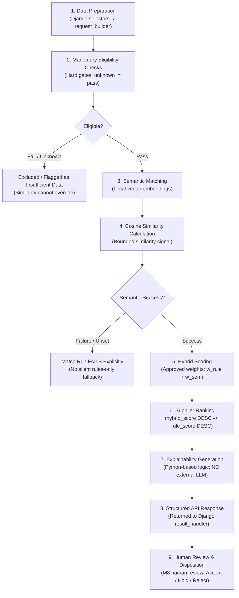

# AI Matching and Data Intelligence — Workstream Specification (C7)


**Lead Engineer:** Alok Tiwari (`@role: ai`, `@role: matching`)

**Workstream:** C7 — AI Matching and Data Intelligence

**Module:** M7 (Supplier–Buyer Matching) / M6 in MVP Features

**Document Status:** Working Baseline & Architecture Specification


---


## 1. Overview and Purpose


The AI Matching and Data Intelligence workstream is responsible for the design, implementation, evaluation, and documentation of the intelligent supplier matching engine for InChi Pilot Gateway v0.1.


The primary objective is to match buyer requirements against supplier capabilities using a combination of:

1. **Mandatory eligibility checks (hard filters)**

2. **Semantic understanding and vector embeddings**

3. **Cosine similarity calculation**

4. **Approved hybrid scoring**

5. **Supplier ranking**

6. **Transparent, Python-based explainability**

7. **Human-in-the-loop review**


### Core Principles

- **Mandatory rules before similarity:** A candidate failing mandatory criteria cannot be rendered eligible merely because its semantic similarity score is high.

- **Unknown is not a pass:** Missing or unknown mandatory data is flagged as `Insufficient Data` and never treated as an automatic pass.

- **Semantic matching is mandatory:** Semantic embeddings capture deep meaning beyond exact keywords. If semantic processing fails, the run fails explicitly with status `Failed`; **no silent rules-only fallback is permitted**.

- **Deterministic Python explainability:** Explanations show exact criterion outcomes, score contributions, similarity signals, and data gaps. No external LLM is required or permitted without approval.

- **AI assists, humans decide:** The engine produces explainable recommendations. AI recommends, ranks, explains, and flags uncertainty; **AI must never autonomously approve or reject suppliers**. Only an authorised human reviewer (M8) makes supplier approval, rejection, or hold decisions.


---


## 2. Two-Component Architecture


The workstream operates across two logically distinct components located within `backend/`:


```text

backend/

├── apps/

│   └── matching/               <-- Component A: Django Matching Integration Layer

└── ai_matching/                <-- Component B: FastAPI AI Matching Engine

```


### Component A: Django Matching Integration Layer (`backend/apps/matching/`)

Coordinates business workflows within Django:
- `selectors/supplier_selector.py`: Owns matching selector workflow and integration. Database query design, candidate queries, and query optimization remain Vishal's responsibility (coordinated with Vishal).
- `services/request_builder.py`: Prepares matching request payloads and validates schemas.
- `services/matching_client.py`: Communicates with the FastAPI AI Matching Engine over HTTP.
- `services/result_handler.py`: Handles FastAPI response processing and persistence coordination atomically. It does not independently own or modify database models, migrations, or schema.
- DRF endpoints, serializers, and permissions remain owned by Abhishek; database models (`MatchRun`, `MatchResult`) and migrations remain owned by Vishal.
- Contains integration and workflow tests in `tests/`.

### Component B: FastAPI AI Matching Engine (`backend/ai_matching/`)

A dedicated Python/FastAPI service executing the AI algorithms:

- Validates request schemas using Pydantic.

- Normalises and preprocesses input data.

- Evaluates mandatory eligibility hard gates.

- Generates vector embeddings for requirement text and supplier capabilities.

- Calculates bounded cosine similarity.

- Computes approved hybrid scores and sorts eligible candidates.

- Generates structured, deterministic Python-based explanations.

- Contains standalone unit tests for all mathematical and algorithmic components.


---


## 3. Proposed Target Folder Structure (Design Specification — Not Implemented Code)

> [!NOTE]
> The folder structure below is the **planned target layout** for C7 workstream implementation. As of 5 November 2026, **none of these application folders or files exist yet** (the repository remains in the documentation and design phase). Implementation will begin only upon explicit authorization. Database models, migrations, and table schemas remain strictly owned by Vishal (C6), and DRF endpoints/serializers coordinate with Abhishek (C5).


```text

backend/

│

├── apps/

│   └── matching/

│       ├── __init__.py

│       ├── apps.py

│       ├── models.py                     # MatchRun, MatchResult, MatchExplanation

│       ├── serializers.py                # DRF serializers for API request/response

│       ├── views.py                      # Trigger matching run & fetch results

│       ├── urls.py                       # Routing for matching endpoints

│       ├── permissions.py                # Role-based access control checks

│       ├── exceptions.py                 # Custom Django matching exceptions

│       │

│       ├── services/

│       │   ├── __init__.py

│       │   ├── matching_client.py        # HTTP client communicating with FastAPI (owned by Alok)

│       │   ├── request_builder.py        # Assembles and validates payload schema (owned by Alok)

│       │   └── result_handler.py         # Handles response processing & persistence coordination (owned by Alok)

│       │

│       ├── selectors/

│       │   ├── __init__.py

│       │   └── supplier_selector.py      # Matching selector workflow & integration (owned by Alok; query optimization by Vishal)

│       │

│       └── tests/

│           ├── __init__.py

│           ├── test_views.py             # API view and permission tests

│           ├── test_services.py          # Service orchestration tests

│           ├── test_request_builder.py   # Request payload formatting tests

│           └── test_integration.py       # End-to-end Django-to-FastAPI integration tests

│

└── ai_matching/

    ├── __init__.py

    ├── main.py                           # FastAPI application entry point

    │

    ├── api/

    │   ├── __init__.py

    │   ├── dependencies.py               # Shared API dependencies

    │   └── routes/

    │       ├── __init__.py

    │       ├── health.py                 # Liveness & readiness probes

    │       └── matching.py               # POST /match endpoint

    │

    ├── schemas/

    │   ├── __init__.py

    │   ├── supplier.py                   # Supplier & product capability schemas

    │   ├── requirement.py                # Buyer requirement & criteria schemas

    │   ├── matching_request.py           # Request payload contract

    │   └── matching_response.py          # Response payload contract (ranked results & explanations)

    │

    ├── core/

    │   ├── __init__.py

    │   ├── config.py                     # Environment settings & thresholds

    │   ├── constants.py                  # Default constants & status enums

    │   └── exceptions.py                 # Engine-specific domain exceptions

    │

    ├── engine/

    │   ├── eligibility/                  # Mandatory eligibility rule evaluation

    │   ├── semantic/                     # Embedding generation & cosine distance math

    │   ├── scoring/                      # Hybrid score calculation (rules + semantic)

    │   ├── ranking/                      # Candidate sorting & tie-breaking

    │   └── explainability/               # Transparent Python explanation generation

    │

    ├── embeddings/                       # Embedding loader, caching, vector math

    ├── providers/                        # Local embedding provider abstraction

    │

    └── tests/

        ├── __init__.py

        ├── test_eligibility.py           # Hard gate evaluation tests

        ├── test_semantic.py              # Semantic similarity & cosine math tests

        ├── test_embeddings.py            # Local model loading & dimension tests

        ├── test_scoring.py               # Hybrid scoring weight formula tests

        ├── test_ranking.py               # Sorting order & tie-break tests

        └── test_explainability.py        # Explanation structure & data gap tests

```


---


## 4. The 9-Stage Matching Pipeline





### Detailed Pipeline Stages


1. **Stage 1 — Data Preparation and Normalisation:**

   - Buyer requirement criteria (mandatory vs preference) and supplier capabilities are gathered from Django ORM via `supplier_selector.py`.

   - Normalised, validated, and formatted into `MatchingRequest` schema by `request_builder.py`.


2. **Stage 2 — Mandatory Eligibility Checks (Hard Gates):**

   - Each candidate is evaluated against mandatory criteria (e.g., category, certifications, capacity, MOQ, price ceiling, export capability, delivery terms — illustrative criteria examples pending formal BNCS approval under D-03).

   - If a supplier fails any mandatory criterion, they are marked `Excluded`. A high semantic similarity score cannot override this failure.

   - Missing or unknown mandatory data is flagged as `Insufficient Data` and excluded from eligible ranking.


3. **Stage 3 — Semantic Matching (Mandatory):**

   - Embeddings are generated locally for requirement descriptions and supplier capability texts.

   - Semantic matching is mandatory.


4. **Stage 4 — Cosine Similarity Calculation:**

   - Computes cosine similarity between requirement vector and candidate vectors.

   - **Explicit Failure:** If semantic processing fails, the run is terminated with status `Failed`. No silent fallback to rules-only matching is permitted.


5. **Stage 5 — Hybrid Scoring:**

   - Combines the weighted rule score and the bounded semantic score using approved business weights:

     $$\text{hybrid\_score} = (w_{\text{rule}} \times \text{rule\_score}) + (w_{\text{sem}} \times \text{semantic\_score})$$

   - Unapproved placeholders (`v0-UNAPPROVED.json`) are used until BNCS approves final weights (D-05, D-06).


6. **Stage 6 — Supplier Ranking:**

   - Eligible suppliers are sorted by `hybrid_score` descending.

   - Tie-breaking: `rule_score` descending, then `supplier_id` ascending.


7. **Stage 7 — Explainability Generation:**

   - Deterministic Python logic generates a structured breakdown for each candidate:

     - Mandatory criteria passed / failed.

     - Rule score breakdown per preference criterion.

     - Semantic similarity contribution.

     - Missing information and data gap warnings.

   - **No external LLM** is used for explainability (D-20).


8. **Stage 8 — Structured Response & Persistence:**

   - The FastAPI engine returns `MatchingResponse` to Django's `result_handler.py`.

   - Results are persisted atomically in `MatchRun` and `MatchResult` records, and an immutable `AuditEvent` is created.


9. **Stage 9 — Human Review and Decision:**

   - Results are presented in M8 for an authorised user (`reviewer` or `platform_admin`) to record a disposition (`Accepted`, `Rejected`, `On hold`) with a mandatory reason.
   - **AI recommends; humans decide:** AI must never autonomously approve or reject suppliers.


---


## 5. Team Ownership and Integration Boundaries


| Interface Partner | Shared Boundary / Contract | Coordination Rule |

|---|---|---|

| **Abhishek Kumar (C5 - Backend)** | `matching_client.py` ↔ DRF API views; Review (M8) & Opportunity (M9) hooks | Co-own API/schema contracts. Abhishek owns core Django services, DRF endpoints and serializers; Alok owns matching workflow services and FastAPI engine. |

| **Vishal Chauhan (C6 - Data/DB)** | PostgreSQL schema, database models (`MatchRun`, `MatchResult`), migrations, pgvector extension & vector columns (D-12), database-level candidate queries and query optimization | Vishal owns all database models, migrations, tables, schema implementation, and query optimization. Alok coordinates selector integration and data needs. |

| **Adrika T Kumar (C3 - UX/Workflow)** | Criteria schema (mandatory vs preference distinction), explanation display formats | Adrika specifies workflow meaning; Alok implements calculation logic. |

| **Priyanka Singh (C4 - Frontend)** | Next.js API client consumption of matching results and explanation fields | Priyanka renders the UI; Alok provides structured API responses from Django. |

| **Harish Pal (C8 - QA)** | Test strategy, negative test cases, evaluation dataset | Harish verifies independent test cases; Alok provides algorithm unit tests and evaluation scripts. |

| **Ajendra Nath Tripathi (C2 - Security)** | AI-service threat model, data protection, embedding model vetting (D-11), no LLM check (D-20) | Ajendra audits security; Alok ensures local execution without data leakage. |

| **Aryan Ghai (C1 - Governance)** | Decision tracking (D-03, D-05, D-06, D-11, D-15), sprint review packs | Aryan tracks open decisions; Alok reports status and evaluation evidence. |


---


## 6. Open Decisions and Confirmation Status


| Decision ID | Topic | Status | Owner |

|---|---|---|---|

| **D-03** | Mandatory eligibility criteria definitions | Pending BNCS Approval (criteria examples are illustrative) | BNCS |

| **D-04** | Eligibility rule format and configuration schema | Proposed (JSON schema) | Alok + Abhishek |

| **D-05** | Preference criteria list | Pending BNCS Approval | BNCS |

| **D-06** | Scoring weights ($w_{\text{rule}}$, $w_{\text{sem}}$) | Pending BNCS Approval (placeholder in `v0-UNAPPROVED.json`) | BNCS |

| **D-11** | Local embedding model selection | **TBD / Proposed / Pending Confirmation** (Sentence-Transformers vs FastEmbed) | Alok + Ajendra + Mentor |

| **D-12** | Database vector storage strategy | **Proposed / Pending Confirmation** (co-owned with Vishal; Vishal owns models/migrations) | Alok + Vishal |

| **D-15** | Matching engine runtime and deployment arrangement | **Proposed / Pending Confirmation** (FastAPI service in backend directory) | Team + Mentor |

| **D-20** | LLM provider and model | **None in v0.1** (Explicitly out of scope) | BNCS + Mentor |
